  

> Application d'émargement en Symfony — exercice de reproduction fonctionnelle, BTS SIO option SLAM.

   

**Statut** — 🎓 Projet de formation, 2024

---

# Émargement — Symfony

## Le problème

Reproduire une application d'émargement existante à partir de son comportement seul, sans accès à son code : l'exercice porte sur la modélisation et sur le choix des briques, pas sur la copie.

## Ce que fait le projet

- Modèle de données et migrations avec Doctrine
- Authentification par jeton JWT (bundle Lexik)
- Pagination des listes (KnpPaginator)
- Export PDF des feuilles d'émargement (dompdf) et envoi par mail

## Structure

`src/` le code · `config/packages/` la configuration des bundles · `migrations/` · `templates/` les vues Twig · `tests/`

## Lancer le projet

`composer install`, configurer `DATABASE_URL` dans un `.env.local`, puis `php bin/console doctrine:migrations:migrate` et `symfony serve`.

---

Développé par **Bakari Abidina** · [bakabi.fr](https://bakabi.fr)
